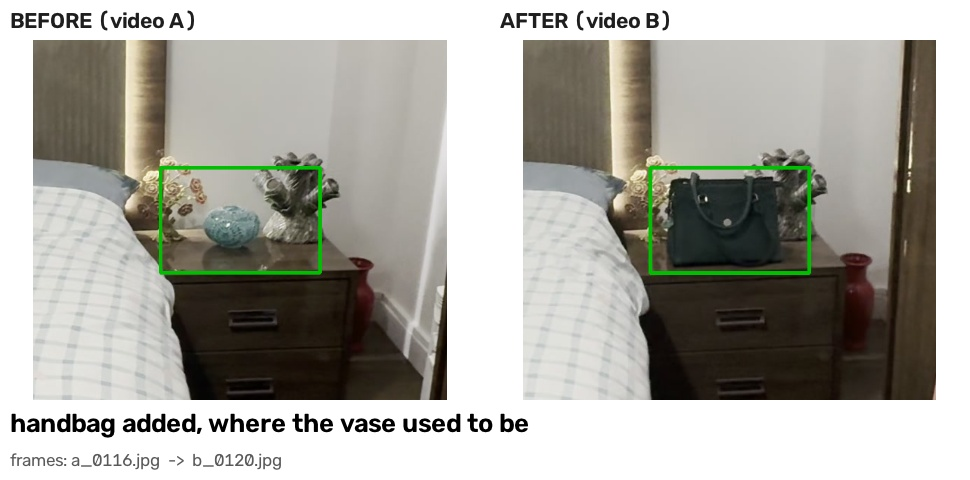

# Room inspection

Between two video recordings of the same room the system built a shared 3D model between both of them, the detector checks which item was added, removed or changed within the setting. Additionally, it recorded the estimated widths of the items, distance moved of the displaced item, so the occlusion was handled in an explicit manner checking any difference which may have happened, it checks if each difference is real or something hidden within both scenes.

## The result

- Vase moved 103 cm
- Handbag added where the vase used to be
- Paper towel roll removed

39 possible changes were detected between the two videos, the system rejects the other possible changes by checking them against the opposite video source, the three items that were added, moved or removed were detected within these changes.

The previous spot of the vase is hidden behind the added handbag, instead of guessing the whereabouts of the vase, it notices a vase appeared on the bed also of similar size and pairs them as a singular move, concluding that the vase was displaced.

## Decomposition of the system

1. Two videos recorded 60FPS 1080p quality showing the same area of the before and after of the room changes, both at slightly different perspectives turned into 2FPS (121 frames each)

2. All 242 frames put into one COLMAP reconstruction, both videos share the same coordinate systems without any separate alignment, all frames were registered. Each video has a dense point cloud built within the shared space.

3. Points in the 'after' cloud with nothing nearby it in the 'before' cloud are considered possible additions, and the reverse would consider possible removals. They are grouped into blobs which means there were 39 detections, where the thresholds are relative to the size of the scene because of COLMAP's arbitary unit system .

4. Rays are casted from the other video's camera blob through the position with four possible outcomes given: seen empty, something there, blocked view or nothing reconstructed. A special case was given where an item blocking a view was considered a change considered as a "covered by" blob.

5. Each verified change there is a photo cropped and labelled with "CLIP" which is an image model ran locally. A removed and added blob is paired together and considered to be "moved" when they have the same label and similar size. Measurements of the bed were made to convert the distances into centimetres. The output given is the report of the before and after panels as well as a 3D view.

## Key decisions and tradeoffs

1. Joint COLMAP reconstruction of all frames - Since both videos would land in the same coordinate system, alignment step would likely not go wrong, the videos needed to overlap enough to be registered together and all 242 frames were successful.

2. Separate dense cloud per video - Allows for a before and after cloud within the workspace, which took ~45 minutes per video to densify

3. Thresholds similar to scene size - COLMAP uses arbitary units, so a point must count by moving 3-4 centimetres. This meant smaller movements can't be detected so lower thresholds would bring noise.

4. Ray casting - Checking the visibility from the video's camera, allowing it to remove 35/39 of the detections. This meant it was quite cautious, and that it would rather miss a change than report a false detection.

5. Special case label pairing - Allowed for a resolution for the vase and handbag case, depends on both objects having considered labels.

6. CLIP running locally - Could be reproduced without an API key so it can only choose from the list I made and looks at one photo per object.

7. Scale made from one tape measurement - I had measured the foot of my bed (145 cm) allowing this to make a scale for other object measurements, one measurement limits the accuracy to +-10%, which may be unreliable for smaller objects.

## Issues and resolutions

1. The vase movement was initially undetected, I resolved this by making the voxel scene finer and the threshold from 3 to 2 voxels.

2. Added handbag and initial vase spot cancelled eachother out, they had blocked each other's check and had become rejected, to which the 'covered by' special case was used to resolve this issue.

3. Size inflation of the boxes had aligned to the tiltes axes in COLMAP which lead to the vase pairing being blocked at first, I changed the measuring along the axes of each object and ignored stray points.

## Accuracy

- Bedside table: vase moved 117 cm but detected as 103 cm (-12%), the handbag width is 31 cm but recorded as 38 cm (+23%) presumably because of the strap of the handbag being recorded in width measures,
- Dressing table: paper towel roll height is 20 cm but recorded as 15 cm (-25%).
- All real changes found, 0 false alarms with possibilities narrowed down
- Data based off of one scene, which does not prove any success rate

## Limitations and evaluation
- Tested on one singular room, therefore accuracy of the system cannot be determined accurately
- Scene consisted of mirrors, blank walls and glossy surfaces which may have had impacts on reconstruction
- Movements under 3-4 cm cannot be seen, sizing is very rough
- For any future purposes, I would test more scenes, align the objects with height displacement from the ground, potentially output an updated obstacle map for robotic navigation.

